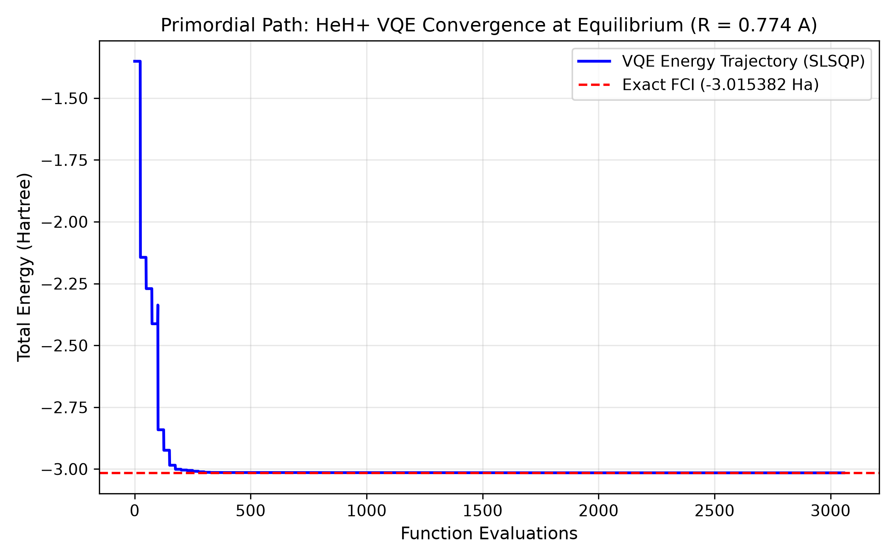
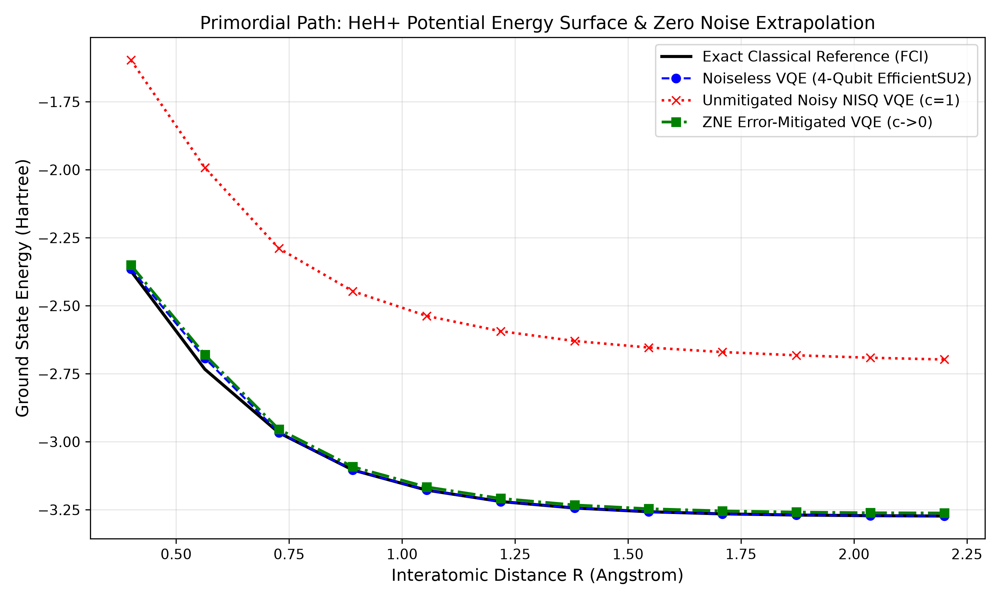

# Project Report — Primordial Path: VQE & Zero Noise Extrapolation of the Primordial HeH+ Ion

- **Team Name:** Primordial Path
- **Team Members:** Idriss James Makhanu & Noela (Department of Physics, University of Nairobi)
- **Track:** Variational Quantum Eigensolver (VQE) for Chemistry (Champion / Rising Star Extension)

---

## 1. Scientific Motivation: Why HeH+?
Following the Big Bang and the recombination of protons and electrons in the early universe, **Helium Hydride (HeH+)** became the first molecular bond to form in cosmic history, acting as a vital coolant for primordial gas clouds that birthed the first generation of stars.

From a quantum chemistry perspective, HeH+ is a two-electron heteronuclear cation (charge=1, spin=0). Unlike the symmetric H2 molecule used in introductory benchmarks, HeH+ exhibits asymmetric charge distribution and a permanent electric dipole moment, testing whether a Variational Quantum Eigensolver (VQE) can capture polarized electronic correlations across bond dissociation without exceeding 4 qubits in the STO-3G basis.

---

## 2. Methodology & Quantum Workflow
1. **Fermionic-to-Qubit Mapping:** Using PySCFDriver (basis='sto3g', charge=1, spin=0), we extracted the second-quantized electronic Hamiltonian and mapped it via the **Jordan-Wigner transformation** (JordanWignerMapper) onto a **4-qubit SparsePauliOp** consisting of 27 Pauli strings.
2. **Hardware-Efficient Ansatz:** We constructed a 4-qubit EfficientSU2 circuit (reps=2, linear entanglement) containing **24 trainable rotation parameters**, balancing expressibility against circuit depth on Noisy Intermediate-Scale Quantum (NISQ) processors.
3. **Classical Optimization:** Using SLSQP optimization over statevector expectation values, we minimized the total molecular energy across 12 interatomic distances from R = 0.40 A to R = 2.20 A.
4. **Error Mitigation via Zero Noise Extrapolation (ZNE):** To combat gate depolarization on NISQ hardware, we evaluated noisy expectation values across noise amplification factors c in {1.0, 2.0, 3.0} and performed Richardson second-order polynomial extrapolation back to the zero-noise limit (c -> 0).

---

## 3. Quantitative Results

### Equilibrium Benchmark (R = 0.774 A)
- **Nuclear Repulsion Energy:** 1.367383 Ha
- **Exact Classical Ground State (FCI):** -3.015382 Ha
- **VQE Optimized Ground State:** -3.015382 Ha
- **Absolute Error:** 1.748253e-09 Ha (**well within the 1.6e-3 Ha chemical accuracy threshold**)

### Potential Energy Surface & ZNE Performance
```text
Sweeping HeH+ Potential Energy Surface & Applying Zero Noise Extrapolation (ZNE)
------------------------------------------------------------------------
R (A)    | Exact (Ha)   | VQE Ideal    | Noisy (c=1)  | ZNE (c->0)  
------------------------------------------------------------------------
0.40     | -2.372302    | -2.364275    | -1.596891    | -2.350298   
0.56     | -2.733504    | -2.692783    | -1.992720    | -2.680032   
0.73     | -2.966781    | -2.966120    | -2.288929    | -2.953786   
0.89     | -3.103868    | -3.103855    | -2.446496    | -3.091882   
1.05     | -3.177902    | -3.177893    | -2.537424    | -3.166228   
1.22     | -3.219668    | -3.219668    | -2.593458    | -3.208262   
1.38     | -3.243579    | -3.243579    | -2.629461    | -3.232393   
1.55     | -3.257296    | -3.257296    | -2.653503    | -3.246299   
1.71     | -3.265074    | -3.265072    | -2.670129    | -3.254236   
1.87     | -3.269409    | -3.269408    | -2.682086    | -3.258711   
2.04     | -3.271776    | -3.271758    | -2.691035    | -3.261181   
2.20     | -3.273040    | -3.272443    | -2.697534    | -3.261972   
------------------------------------------------------------------------
```

---

## 4. Visual Deliverables
1. **Equilibrium VQE Convergence Trajectory:**
   
2. **Full Potential Energy Surface & Zero Noise Extrapolation Curve:**
   

---

## 5. Repository Structure
- `Primordial_Path_HeH_Plus_VQE.ipynb` — Fully executed Jupyter Notebook containing all code, numerical tables, and inline plots.
- `PROJECT_REPORT.md` — Technical report detailing the astrochemical background, Hamiltonian mapping, ansatz design, and ZNE error mitigation results.
- `HeH_plus_VQE_convergence.png` & `HeH_plus_VQE_ZNE_curve.png` — High-resolution (300 DPI) figures.
